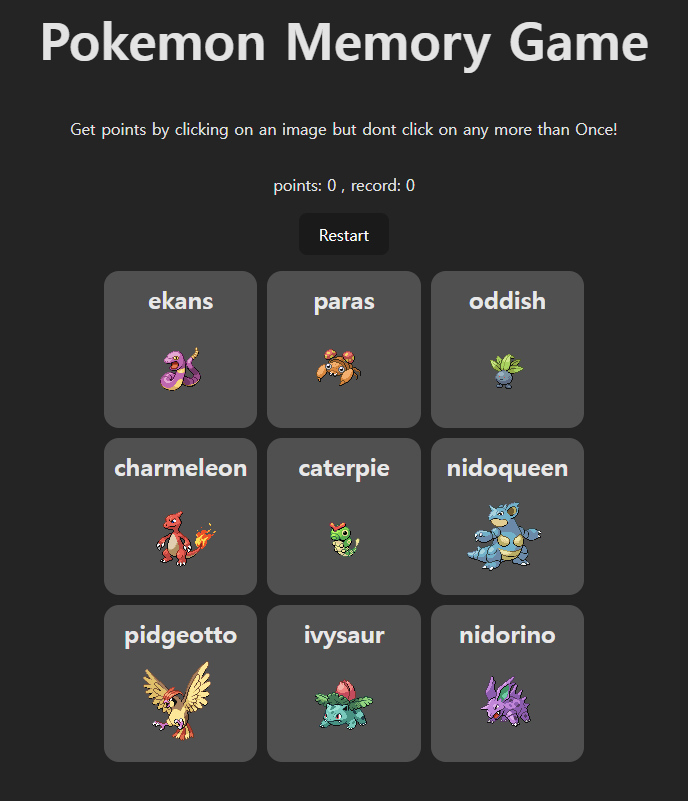
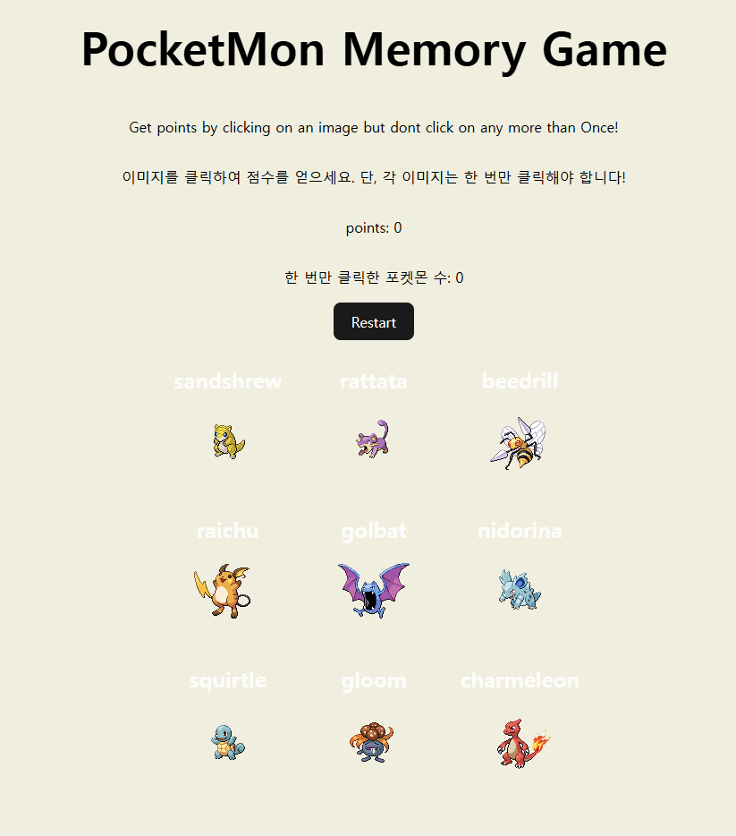

OSS 02분반 22400330 백예원 

소개: 포켓몬 기억 게임 
선택 이유 : 사용자가 입력했던 정보를 기억하는 백엔드가 어떻게 구성되어있는지 궁금했다 
주요 기능 : 1. 3x3 이미지 표에서 캐릭터를 고르면 포인트가 올라간다 
2. 중복되는 이미지를 고른경우 즉시 게임이 종료된다 

수정 내용 : 
1. 디자인 / 문구
2. record가 어떤 역할을 하고 있는지 지정되어있지 않음 - 기록용이긴 하나 리액트가 임시로 관리하는 데이터이기 때문에 새로고침하면 내용이 사라짐 - 대체 : 최고 기록이 아닌 한번만 누른 포켓몬의 수를 나타내도록
3. 게임이 종료된 후, 아무런 안내사항이 없음

코드 분석: 
import 통한 다른 파일과의 연결 - 다른 파일의 컴포넌트 가져오기 
export 컴포넌트를 외부로 내보내기 
import - react와 스타일 시트와 연결 
gurl을 변수로 api 설정 
a) 메모리 컴포넌트 
-게임 전체의 상태 - 점수/클릭처리 등
[포함되는 함수]
1. 랜덤 숫자 생성 함수 - min부터 max-1의 숫자를 랜덤으로 생성 
범뤼를 조정하고 Math.random으로 무작위로 반환 
2. 포켓몬 클릭 처리 함수 - 스프레드, map 사용 
3. 버튼을 눌렀을 때 실행되는 함수  - useEffect 2개; 컴포넌트가 처음 화면에 나타날 때

b) 아이템 컴포넌트 
-데이터 요청, 이름/이미지 출력 
[역할]
useState,  fetchPokemon

주소 
vercel : https://pokemon-memory-game-git-main-yewonbaek.vercel.app/
git: https://github.com/baekyewoa0727-jpg/Pokemon-Memory-Game.git
assign: https://github.com/2026-2-OSS/assign10-c02-22400330.git
원본 주소 : https://github.com/Facundo-byte/Pokemon-Memory-Game.git

수정 전

수정 후

주요 파일: 
app.jsx, styles, main.jsx, index.html

Weekly Review:
새롭게 배운 내용 3가지 - 
1. export - 두번쨰 export : item 요소를 외부에서 사용할 수 있도록 내보내고 fetch() 를 통해 데이터를 가져옴
2. setposition - 상태 변경함수 . 포케몬 클릭 여부를 저장하는 배열 변경 
3.  useEffect - 클릭이 변경되면 useEffect가 다시 실행되어 포케몬 이미지 새롭게 배치 
어려웠던 점과 해결 방법 - record라는 기능은 있는데 새로고침 할때마다 기록이 사라졌다. 코드 내부에서는 지정된 역할이 있는데 실제 기능을 파악하기 힘들어 오래걸렸다. ai를 활용해서 코드에서 어떤 역할이 부여되어있는지 확인했고, location 기록이이라 새로고침할때 사라지는 기능임을 깨달아 처음 선택한 캐릭터를 기록하는것으로 기능과 이름을 변경했다. 
AI 활용 내용 및 느낀 점 - jsx문법에 익숙하지 않아 코드 분석과 jsx 설명에 많은 도움을 받았다. 또 react를 사용할때 여러가지 폴더가 생기는데 각 폴더의 기능이 궁금해 설명을 받는것에 도움을 받았다. 